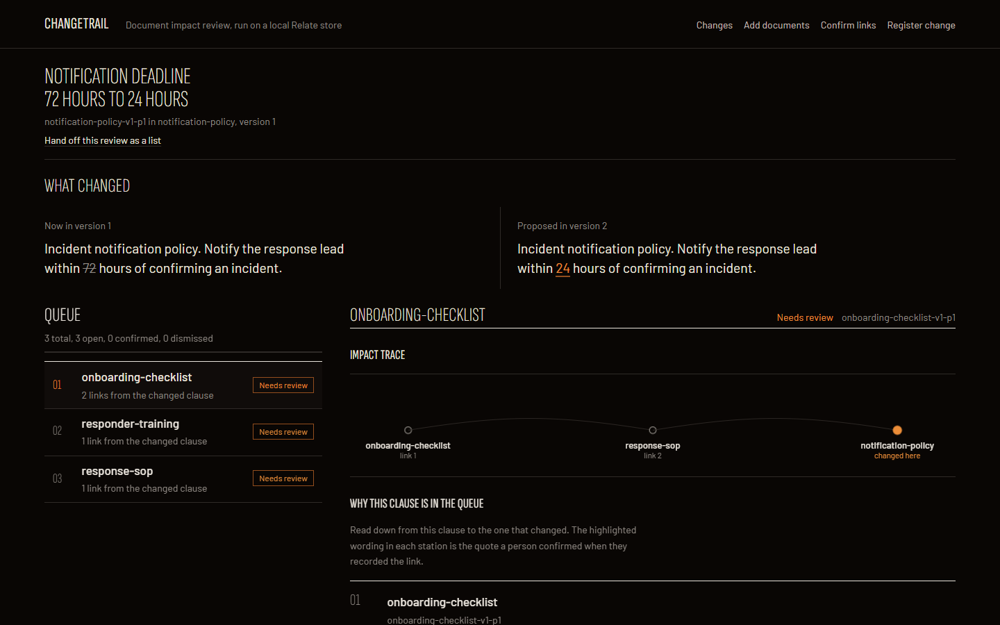
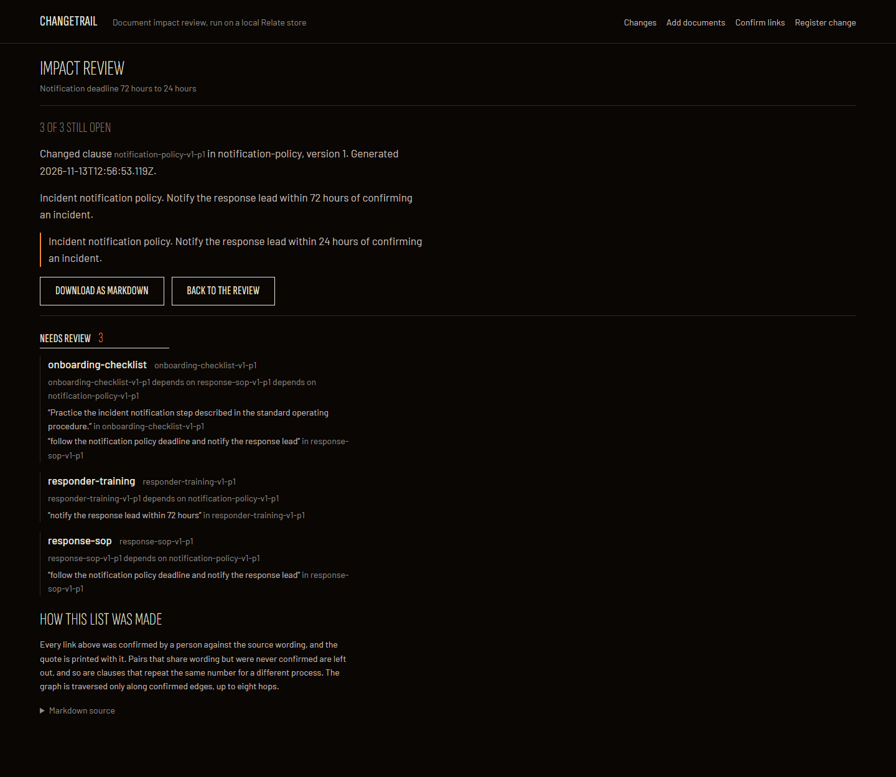

# ChangeTrail

When a rule changes, find every operational document that has to change with it, and show the evidence for each one.

ChangeTrail is a local review workbench built on [Relate](https://relatedb.ai), Neo4j's embedded graph database. You import documents, confirm which clause depends on which, register a change to one clause, and then review the downstream clauses a person can see are affected. Every relationship in the graph was confirmed by a human and keeps the exact wording that justified it.



## Use case

Operational documents are not independent. A policy states a deadline, an SOP points at the policy instead of restating it, a checklist says "follow the SOP", and a training slide repeats the old number. When the policy changes, the SOP may still be correct while the training slide is now wrong. A text search cannot tell those apart: it finds the documents that repeat the old number and misses the ones that reference it.

The relationships that matter are the dependency edges between clauses, plus the provenance of each edge:

- a clause **implements** a requirement (the SOP pointing at the policy)
- a clause **references** another without restating it (the checklist)
- a clause **teaches** or **restates** it (the training slide)
- a clause merely **shares wording** with another and depends on nothing (the equipment paragraph that also says "72 hours")

The last one is the point of the whole design. Shared wording is a candidate, never a conclusion.

Worked example, run on the included fixtures: changing the incident notification deadline from 72 hours to 24 hours. The confirmed graph returns three clauses. A literal text search returns two of the same three, misses the checklist (which never repeats the number), and adds the unrelated equipment-returns paragraph. Both results are printed side by side by `npm run spike`.

## How it uses Relate

- **Mode: single file.** Each demo store is one `.rl` file committed to this repo.
- **Why this mode:** the judges have to inspect the graph without running a service or a database server, and a reviewer should be able to copy the store, archive it, or delete it when done. One file does that. Relate's other modes were considered and rejected: `:memory:` disappears when the process stops, so the data could not be inspected at all, and a directory store adds files without adding anything a single-file demo needs. The same code path works with a directory store if a project ever needs concurrent readers beside one writer.
- **What the graph models:**

  | Node | Meaning |
  | --- | --- |
  | `Clause` | one paragraph of one version of one document, with a stable id `<document>-v<version>-p<n>` |
  | `Change` | one registered change, pointing at the clause it changes |
  | `SuggestionDecision` | a pair of clauses a reviewer looked at and ruled out |

  | Relationship | Meaning |
  | --- | --- |
  | `(Clause)-[:DEPENDS_ON]->(Clause)` | confirmed dependency, carrying the `quote` that justifies it, the `provenance` (`manually-confirmed`), the reviewer and the time |
  | `(Change)-[:CHANGES]->(Clause)` | the clause this change alters |
  | `(Change)-[:PROPOSES]->(Clause)` | optional replacement wording from a different version |
  | `(Change)-[:REVIEWED]->(Clause)` | one decision, with `status`, `reason`, `reviewer`, `at` and an explicit `seq` |

  Impact traversal follows `DEPENDS_ON` up to eight hops and only accepts paths where **every** edge is `manually-confirmed`. A suggested pair is never an edge, so it can never reach a review queue. A proposed replacement clause is stored beside the change rather than rewired into the graph, so recording a proposal cannot silently change what depends on what.

## Setup and run

Prerequisites: Node.js 22 or newer. Tested on Windows 11 with Node 24 and Relate 1.0.0. No database server, no API key, and no model call is needed for anything below.

```sh
npm ci
npm test
npm start
```

Then open <http://127.0.0.1:4173>.

`npm start` copies the committed store to `.work/workbench.rl` on first run and reviews that copy, so `data/imported.rl` stays pristine and every clone starts from the same queue. Delete the working copy to start over. `PORT` and `STORE` are read from the environment if you want a second instance.

First result in five steps, in the order a reviewer works:

1. **Add documents** (`/import`). Paste plain text, one paragraph per clause. Importing creates clauses only, no links. Try the fixture text from `fixtures/raw-docs.json`.
2. **Confirm links** (`/links`). Pairs that share wording are shown side by side with the overlap highlighted. Set the direction, or dismiss the pair. Nothing is added to the graph until you do.
3. **Register a change** (`/changes/new`). Pick the clause that changed, optionally with replacement wording from another version.
4. **Review** (`/` then the change). The change screen shows the word-level diff, an impact trace diagram of the confirmed path, the same path as a list with each quote highlighted, a queue of affected clauses, a decision form, and the decision history.
5. **Hand off** (`/change/:id/report`). The same queue as a work list, grouped into what needs an edit, what is still open and what was ruled out, each item with its dependency path and the quote behind every link. `report.md` beside it serves the identical content as a downloadable Markdown file for a ticket or a pull request. Both are generated from one object, so the page and the file cannot disagree.

Nothing reaches a review queue without a person: suggestions stay out of the graph, and the traversal only follows edges whose provenance is `manually-confirmed`.



Headless, without the interface:

```sh
npm run spike     # document-level store, graph result vs literal text search
npm run clauses   # clause-level store, four changes including two negatives
npm run docs      # the store the workbench uses
```

Each of those reads a committed store in read-only mode and prints JSON. To build a fresh store somewhere else instead of overwriting the example:

```sh
node scripts/import.mjs seed .work/my-store.rl
node scripts/import.mjs read .work/my-store.rl
```

Seed commands refuse to overwrite an existing store.

## Where the data lives

| Path | Contents |
| --- | --- |
| `data/imported.rl` | the workbench's store: 12 clauses from 6 document versions, 3 confirmed dependencies, 1 registered change |
| `data/clauses.rl` | clause-level fixture for four changes, including two with no expected impact |
| `data/demo.rl` | the first document-level spike, kept because `npm run spike` prints the text-search comparison from it |

All three are single-file Relate stores committed to this repo. They contain synthetic documents written for this demo. They are not real policy, and nothing here is legal or compliance advice.

## What has been verified

- Native Relate queries run on Windows with no server, no API key and no model call.
- A single-file graph survives process exit and is readable from a fresh process.
- Impact traversal returns the declared clauses for four different changes, including a two-hop dependency and two changes with no expected impact.
- The same-document trap holds: changing the notification deadline does not flag the logging checklist in the same SOP.
- Every returned dependency carries the exact quote that justified it, and a fabricated quote is rejected before anything is written.
- Literal text search misses the indirect checklist and returns an unrelated 72-hour equipment process, while the graph does the opposite.
- Two versions of one document are never suggested as a dependency: a version bump is a supersession, not an edge.

## What this does not prove

- **Suggestion is lexical, not semantic.** It finds shared word runs. Paraphrases are missed, and unrelated pairs surface. That is exactly why every pair needs a person, and why no accuracy number is claimed for extraction: there is no extraction model.
- **The fixtures are small and synthetic.** 12 clauses is a demonstration, not a benchmark.
- **Impact is document-level reachability with clause-level edges.** The engine knows which clause depends on which; it does not parse the changed sentence to decide whether the dependency is actually affected. A returned clause is a **review candidate**, not a proven edit.
- **Paths are bounded to eight hops.**
- **No authentication.** The reviewer name is typed into the form and stored as given, so the audit trail records what someone claimed, not who they were.
- **Import is plain text only.** No PDF, no OCR, no heading hierarchy, no tables. Paragraphs are the clause boundary.
- **The diff is word-level**, so a reordered sentence reads as a large change.
- No pagination and no search.

## Design notes

The interface is server-rendered HTML with form posts: no client-side framework, and no JavaScript is required to read or review. The signature object is the **impact trace**, a hairline SVG diagram generated from the same hop data the list below it renders, so the diagram cannot drift from the evidence. Motion is CSS-only and runs once on load; under `prefers-reduced-motion` every delay collapses to zero and the finished state shows immediately. Nothing animates on scroll and nothing loops.

## Layout

```
src/graph.mjs      Relate store open, document-level seed and traversal (spike)
src/clauses.mjs    clause seed, impact query, review decisions, latest-decision projection
src/import.mjs     paragraph split, clause import, lexical suggestion, confirm, dismiss, change
src/workbench.mjs  read models the screens use
src/report.mjs     the handoff report, page and Markdown from one object
src/ui.mjs         server-rendered markup
server.mjs         node:http routes, no framework
public/            stylesheet, design tokens, generated textures
test/              35 tests, including the HTTP routes and the report
```

## License

MIT for the code in this repository. Relate itself is Apache-2.0 and is used as a dependency.

## Sources

- <https://relate.devpost.com/> and <https://relate.devpost.com/rules>
- <https://relatedb.ai/docs/get-started/node/>
- <https://github.com/relatedb/relate/releases/tag/v1.0.0>
